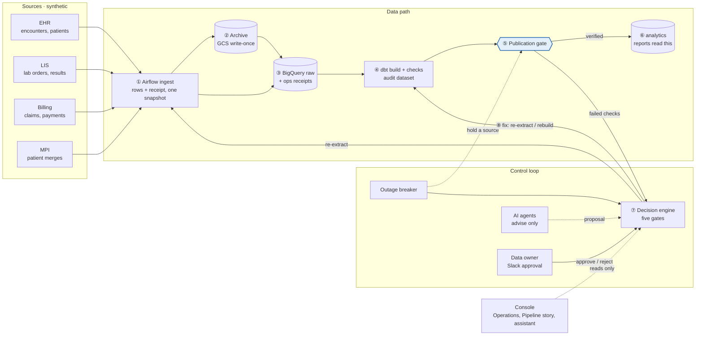
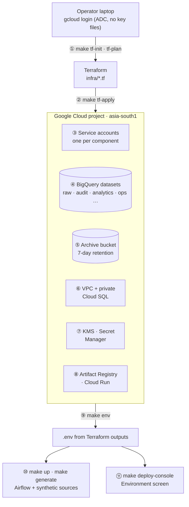
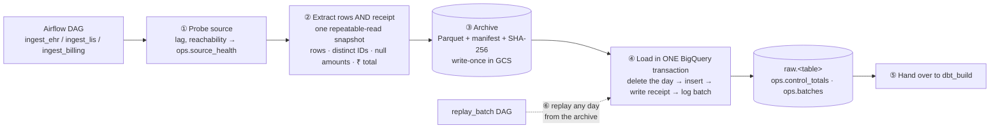
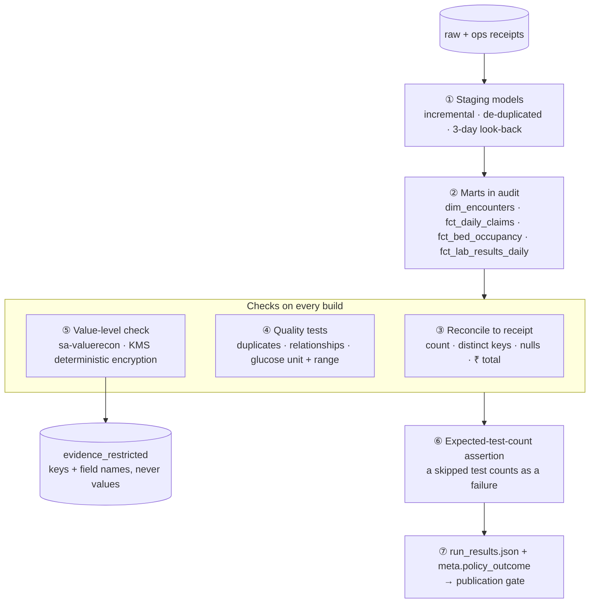
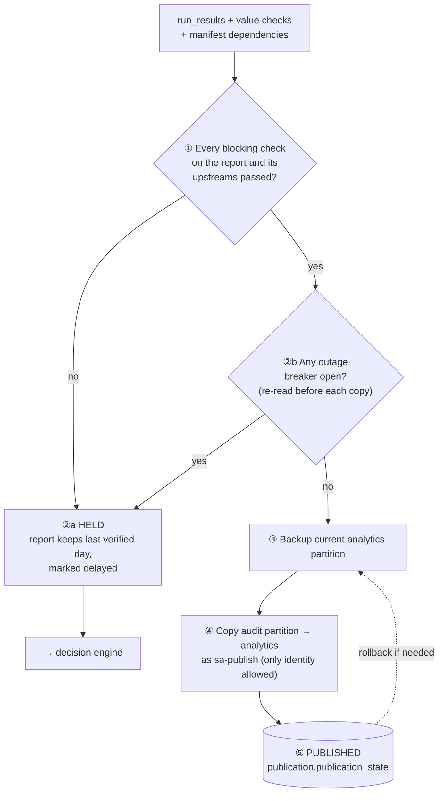
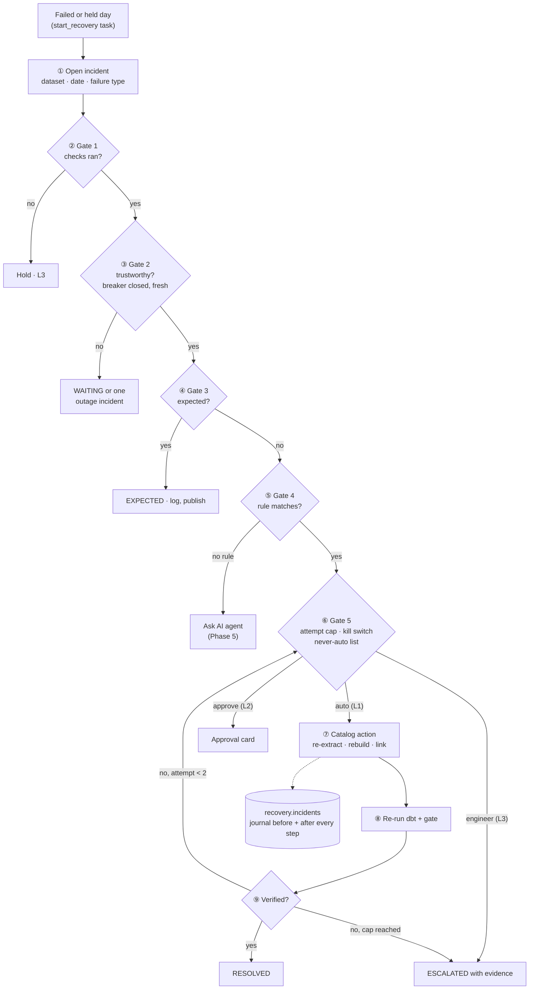
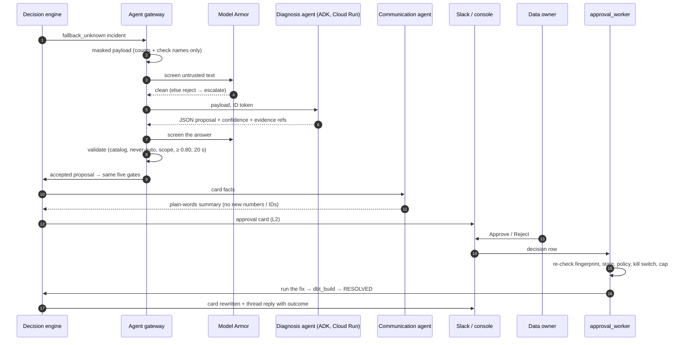
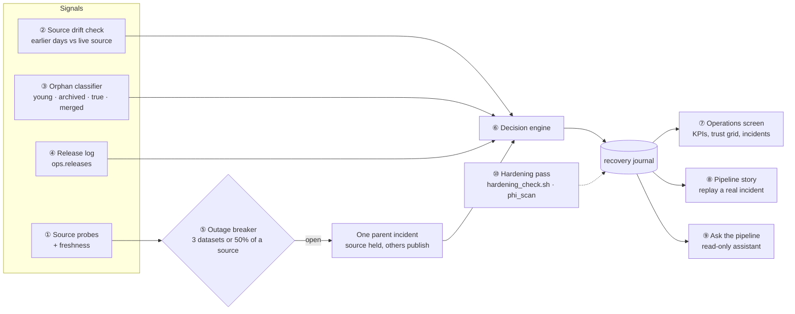

<div align="center">

# Self-Reconciling Data Pipeline

**Bad data is never published. Failures we understand fix themselves and are checked again.**

A proof of concept that wraps a dbt + Airflow pipeline on Google Cloud in a control loop —<br/>
**detect → hold → decide → fix → verify** — proven live on synthetic hospital data.


[**Short runbook (12 pages)**](docs/Reconcile-POC-Short-Runbook.pdf) ·
[Full runbook v2.0](docs/RUNBOOK.md) ·
[Architecture design v5.2](docs/Self-Reconciling-Data-Pipeline-Architecture-v5.2.pdf) ·
[Diagrams](docs/diagrams/)

</div>

---

## Contents

| | Section | For |
|---|---|---|
| 1 | [The problem](#1-the-problem) | Everyone |
| 2 | [The solution in one picture](#2-the-solution-in-one-picture) | Everyone |
| 3 | [Results](#3-results) | Everyone |
| 4 | [End-to-end flow, step by step](#4-end-to-end-flow-step-by-step) | Engineers, architects |
| 5 | [The seven phases](#5-the-seven-phases) — each with a numbered flow diagram | Engineers, architects |
| 6 | [The 23 failure scenarios we proved](#6-the-23-failure-scenarios-we-proved) | Everyone |
| 7 | [The AI agents](#7-the-ai-agents) — how they were built, their scope, when they are called | AI engineers |
| 8 | [Why Terraform](#8-why-terraform) | Cloud engineers |
| 9 | [Repository structure](#9-repository-structure) | Engineers |
| 10 | [Setup and commands](#10-setup-and-commands) | Engineers |
| 11 | [Safety rules](#11-safety-rules) | Contributors |
| 12 | [Status and path to production](#12-status-and-path-to-production) | Everyone |

> **Tip:** circled numbers ①②③ in each diagram match the # column of the table under it. The diagrams are Mermaid, so GitHub draws them live — hover to zoom, or open the
> SVG/PNG copies in [`docs/diagrams/`](docs/diagrams/). Click any ▶ to expand a section.

---

## 1. The problem

Today a data pipeline proves that it **ran**, not that the data is **right**.

| Today | What it costs |
|---|---|
| A nightly load finishes green while 800 hospital visits are missing | The first person to notice is a ward manager reading a wrong bed report |
| Recovery is manual: L1 searches logs for ~30 min, then hands to L2 (data owner) or L3 (engineers) | Slow, inconsistent fixes; nobody can replay why a decision was made |
| A source system goes down and every dataset fails on its own | On-call gets twenty alerts for one problem |
| Expected differences (archived history, merged patients, late records) look like errors | False alarms, or worse, someone "fixes" correct data |

**The promise to report users:** *you may see slightly old figures, but never wrong ones — and late
data is always marked as late.*

## 2. The solution in one picture

We wrap the pipeline in a **control loop**. Every load carries a receipt from the source; data is
held until it is verified; a deterministic engine decides what to do about any failure; and every
fix is checked again before the incident closes.



| Step | What happens | Who acts |
|---|---|---|
| **Detect** | Every extract writes a *receipt* (rows, distinct IDs, empty amounts, ₹ total) from the same database snapshot; the warehouse is checked against it, and lab values are checked one by one | Airflow + dbt |
| **Hold** | Data is built and tested in `audit`; only verified days are copied to `analytics`, which reports read | Publication gate |
| **Decide** | Five fixed questions, in order, pick one safe action or a hand-over | Decision engine |
| **Fix and verify** | Safe fixes run on their own (L1); meaning-changing fixes need the data owner's approval in Slack (L2); code problems go to engineers with evidence (L3). Closed only after a re-check | Engine, data owner, engineers |
| **Advise** | AI agents explain failures no rule covers, and suggest an action — they never act | Gemini via ADK, behind Model Armor |
| **Group** | An outage breaker turns a source outage into one incident; other sources keep publishing | Outage breaker |

## 3. Results

Proven live on 21–27 Oct 2026 — every case injected into the **real** pipeline and followed end to end.

| Measure | Result |
|---|---|
| Failure types proven end to end | **23 of 23** |
| Wrong figures published during all failure runs | **0** |
| Incidents in 7 days / handled with no person | 77 / 19 |
| Median time to resolve | 3.9 min |
| Missing hour re-extracted and published, no person | 1.9 min |
| Patient data in agent calls, cards or the journal (T26) | 0 findings in 18 checks |
| Hardening pass | 17 pass · 1 warning · 0 fail |
| Bugs found only by live runs (all fixed) | 8 |

## 4. End-to-end flow, step by step

What happens to one business day, from source to report:

| # | Step | Component | Output |
|---|---|---|---|
| 1 | Probe each source: reachable? how far behind? | `ingest_sources` DAG | `ops.source_health` |
| 2 | Extract rows **and** the receipt in one repeatable-read snapshot | `extract.py` | rows + control totals |
| 3 | Archive the extract write-once (Parquet + manifest + SHA-256) | `archive.py` → Cloud Storage | replayable original |
| 4 | Load in one BigQuery transaction: delete the day, insert, write the receipt, log the batch | `warehouse.py` | `raw.*`, `ops.control_totals`, `ops.batches` |
| 5 | Build staging and marts in `audit`; reconcile to the receipt; quality and value-level checks | `dbt_build` DAG + dbt | `run_results.json`, `evidence_restricted` |
| 6 | Gate: every blocking check passed and no breaker open? → copy the day to `analytics` | `publish.py` as `sa-publish` | `publication.publication_state` |
| 7 | If held: open an incident and run the five gates | `recovery_engine` DAG, `engine.py` | `recovery.incidents` journal |
| 8 | Act: safe fix (L1), approval card in Slack (L2), or escalate (L3); unknown → ask the AI agent | executor, `approval_worker`, `agent_gateway.py` | actions, cards, `recovery.agent_calls` |
| 9 | Re-run dbt and the gate on the fixed day | `dbt_build` | verified or not |
| 10 | Close the incident only when verified; tell Slack how it ended | `engine.py`, `slack_notify.py` | RESOLVED / ESCALATED |
| 11 | Show it all, read-only | Console: Operations, Pipeline story, assistant | — |

> **How the parts talk:** every flow uses BigQuery tables plus Airflow scheduling and polling (the
> incident journal, approvals, breakers, agent calls). The Pub/Sub topics from Phase 0 exist but are
> not on the critical path in the POC — fewer moving parts to fail.

## 5. The seven phases

Each phase builds on the evidence the previous one produces, and is **done** only when its exit gate passes.

| Phase | Name | What it adds | Exit gate |
|---|---|---|---|
| 0 | Foundations | Terraform environment, identities, synthetic data, policy, console shell, CI | 🟡 3 of 4 (rebuild proof open) |
| 1 | Ingest | Receipts from the same snapshot, write-once archive, idempotent loads, replay | ☑️ 21 Oct |
| 2 | dbt checks | Staging + marts, reconciliation to receipts, value-level checks | ☑️ 22 Oct |
| 3 | Publication gate | Write-Audit-Publish, dependency-aware holds, backups, rollback | ☑️ 23 Oct |
| 4 | Decision engine | Five gates, catalog actions, attempt cap, kill switch, journal | ☑️ 23 Oct |
| 5 | Agents and approvals | Diagnosis + Communication agents, Model Armor, ADK on Cloud Run, Slack | ☑️ 27 Oct |
| 6 | Breaker and operations | Outage breaker, late changes, orphans, Operations, Pipeline story, assistant, hardening | 🟡 23 of 23 proven; demo recording open |

<details>
<summary><b>Phase 0 — Foundations</b>: a secured, empty platform built by Terraform</summary>

**Why:** if identities and networking are improvised later, safety rules become promises instead of
facts. Built first, every later phase inherits them.



| # | What is built | Where |
|---|---|---|
| 1–2 | Whole environment from code, reviewed with `plan` before `apply` | `infra/` |
| 3 | One service account per component — ingest cannot write `analytics`, even if the code is wrong | `infra/iam.tf` |
| 4 | BigQuery datasets: `raw`, `audit`, `analytics`, `quarantine`, `ops`, `evidence_restricted`, `publication`, `recovery`, `agent_context` | `infra/bigquery.tf` … |
| 5 | Archive bucket with retention (Bucket Lock opt-in) | `infra/storage.tf` |
| 6–8 | Private network and Cloud SQL; KMS; Secret Manager; Artifact Registry; Cloud Run | `infra/network.tf`, `kms.tf`, … |
| 10 | Deterministic synthetic EHR / LIS / Billing / MPI data, with real-world mess built in | `data-gen/` |
| 11 | Console shell + Environment screen (identity matrix read from real IAM) | `api/`, `web/` |

**Exit gate:** ☐ destroy + rebuild from scratch · ☑ generator loads a day · ☑ `/api/health` ok · ☑ CI green.
</details>

<details>
<summary><b>Phase 1 — Ingest, control totals and raw archive</b>: every load carries its own receipt</summary>

**Why:** reconciliation needs a trustworthy receipt, recovery needs an untouched copy to replay, and
retries must never double data.



| # | Step | Why |
|---|---|---|
| 1 | Probe the source | Don't extract from a broken source |
| 2 | Rows **and** totals in one snapshot | The receipt and the rows describe the same moment |
| 3 | Write-once archive with checksum | Replay any day weeks later, tamper-evident |
| 4 | One transaction per day | Idempotent: the receipt exists if and only if the rows do |
| 6 | `replay_batch` | Recover from the archive even after the source has moved on |

**Exit gate (G1–G5):** one receipt per batch · re-runs identical · archive replays · ingest cannot
write analytics · archive cannot be overwritten — ☑️ all passed.
</details>

<details>
<summary><b>Phase 2 — dbt models and reconciliation checks</b>: the warehouse is checked against the receipt</summary>

**Why:** a green run proves nothing about the data without these tests. Three numbers, not one —
50 missing + 50 duplicate claims still match on count, but distinct IDs and ₹ totals catch it.



| # | Check | Catches |
|---|---|---|
| 1 | Staging with a 3-day look-back | Late reversals and changes |
| 3 | Reconcile to receipt | Missing hours, offsetting errors, duplicates |
| 4 | Quality tests | Unit changes (glucose mg/dL → mmol/L), broken relationships |
| 5 | Value-level check with KMS | Values changed in transit — evidence keeps keys and field names, **never values** |
| 6 | Expected-test-count | A test silently skipped |
| 7 | `meta.policy_outcome` per test | Tells the gate which failures block |

dbt runs from Airflow (`dbt_build` DAG); value checks run as a separate identity, `sa-valuerecon`, the only one with KMS access.
</details>

<details>
<summary><b>Phase 3 — Publication gate (Write-Audit-Publish)</b>: only verified days reach reports</summary>

**Why:** checks are useless if bad data still reaches reports. The gate turns "a test failed" into
"this day is held, and reports keep yesterday's verified figures, marked delayed".



A report is held if any blocking check on **it or anything upstream** failed, was skipped or did not
run. Breakers are re-read immediately before each copy, so a fix that finished after its source went
down still cannot publish. Only `sa-publish` can write `analytics` — proven by a denied write in Cloud Audit Logs (T9).
</details>

<details>
<summary><b>Phase 4 — Decision engine and recovery executor</b>: five gates, one safe action</summary>

**Why:** replaces the manual L1 loop with decisions that are deterministic, explainable, replayable
and auditable. The same evidence always gives the same decision.



| Gate | Question | Example |
|---|---|---|
| 1 | Did the checks run? | 42 of 42 tests ran, receipt present |
| 2 | Can we trust them? | Replica 12 s behind, no breaker open |
| 3 | Is the difference expected? | Archived history → log, don't fix |
| 4 | Which rule matches? | All missing rows in one hour → `partial_extract` |
| 5 | Do guardrails allow a fix? | Attempt 1 of 2, not never-auto, kill switch off → auto |

**Catalog actions:** `reextract_from_raw`, `rebuild_partition`, `link_unknown_member`, `remap_merged_patient`
(approval), `quarantine_rows` (approval), `wait_and_recheck`, `log_expected`, `hold_publish`, `escalate`.
**Never automatic:** `full_refresh`, `rollback`, `source_delete`. Rules live in
[`policy/policy.yml`](policy/policy.yml) (version `1.8.0-poc.5`); every decision records the version.
</details>

<details>
<summary><b>Phase 5 — AI agents, approvals and notifications</b>: humans approve, agents advise</summary>

**Why:** some fixes change meaning (remapping a merged patient) and need the data owner; some
failures match no rule and need a diagnosis. Neither may give any agent the power to act.



Approvals expire if nobody decides; an approval for data that has since changed is marked **STALE**
and never runs (T24). See [§7](#7-the-ai-agents) for how the agents were built.
</details>

<details>
<summary><b>Phase 6 — Outage breaker, late changes, orphans, operations</b>: the rest of the failure table, and a view of it all</summary>

**Why:** correlated failures must be handled as one, and the remaining failure types (late changes,
archived data, four kinds of orphans, value mismatches, release regressions) need their own signals.



| Piece | What it does |
|---|---|
| Outage breaker | 3 datasets or 50% of a source failing within 30 min → one parent incident, that source held, others publish |
| Source drift check | Compares earlier loaded days with the live source (read-only) → late change / archived history |
| Orphan classifier | Young (link to unknown member), archived parent (expected), true orphan (L2), merged patient (approval → remap) |
| Release log | A failure right after a release is attached to that release as a suspected regression |
| Operations screen | Today at a glance, KPIs, 7-day trust grid, how failures were handled, every agent call |
| Pipeline story | Replays a real incident on a map of the pipeline, step by step — for demos |
| Ask the pipeline | Read-only assistant with grounded answers (every answer cites incident IDs) |
| Hardening | `scripts/hardening_check.sh` + `phi_scan`: secrets, exposure, guardrails, patient data, leftovers |
</details>

## 6. The 23 failure scenarios we proved

Every row was injected into the real pipeline with `scripts/failure_suite.sh` (or the earlier phase
suites) and followed to RESOLVED or ESCALATED. **In every run the affected reports were held until
their checks passed again.**

| Response | Meaning |
|---|---|
| 🟢 Fixes itself | L1: automatic catalog action, then re-verified |
| 🔵 Waits / expected | No data change: wait for the source, or log a correct difference |
| 🟣 A person approves | L2: data owner approves in Slack before anything runs |
| 🟠 Held and handed over | L3 or L2: report held, evidence attached, never fixed automatically |
| ⚫ Grouped | One incident for a whole source outage |

<details open>
<summary><b>All 23 scenarios</b></summary>

| # | Scenario | What was injected | What the pipeline did | Response | Time |
|---|---|---|---|---|---|
| 1 | Partial extract (T10) | 02:00–03:00 visits dropped (117 of 10,012) | Re-extract → rebuild → published, no person | 🟢 | 1.9 min |
| 2 | Duplicate batch (T4) | Retried batch loads 12 claims twice | Warning on raw; staging de-duplicates; rebuild day | 🟢 | — |
| 3 | Offsetting errors (T5) | 50 missing + 50 duplicate claims (count still matches) | Distinct keys + ₹ total catch it → re-extract | 🟢 | 4.3 min |
| 4 | Source timeout | First extract attempt times out | Airflow retried; 10,012 = receipt; no incident | 🟢 | 1.5 min |
| 5 | Late change | 3 claims of 13 Oct reversed after load | Drift check → rebuild 13 Oct | 🟢 | 6.5 min |
| 6 | Change beyond look-back | Same for 11 Oct, older than 3 days | Rebuild that day itself | 🟢 | 11.9 min |
| 7 | Young orphan | Lab result before its visit exists | Linked to the unknown member, re-linked next run | 🟢 | 6.1 min* |
| 8 | Stale feed | Source replica 30 h behind | WAITING, no data change → caught up → RESOLVED | 🔵 | 6.2 min |
| 9 | Late documentation | Only 35% of the day in the source | WAITING → rest arrived → RESOLVED | 🔵 | 5.7 min |
| 10 | Archived history (T12) | EHR archived 10,012 visits of 12 Oct | EXPECTED, no alarm, reports published | 🔵 | 6.5 min |
| 11 | Archived parent (T12) | Child row whose parent is in the EHR archive | EXPECTED, logged | 🔵 | 6.1 min* |
| 12 | Merged patient (T18) | Records on retired patient IDs (real MPI merges) | 3 Slack cards approved → remap → rebuild → RESOLVED | 🟣 | 7.3 min |
| 13 | Missing receipt (T2) | Data loaded with no control totals | Held; approval card; re-extract after approval | 🟣 | 6.2 min |
| 14 | Unit change (T11) | Glucose switched to mmol/L | Held, L3, **never automatic** | 🟠 | — |
| 15 | Critical value mismatch (T6) | 14 lab values rounded in staging | Lab report held, L3; other reports published | 🟠 | 6.5 min |
| 16 | Deployment regression (T14) | A release doubled 25 visits in a join | Release attached; claims report held; 0 data actions | 🟠 | 5.0 min |
| 17 | dbt build error | Model fails to compile | All 3 reports held, 0 data actions → clean build → RESOLVED | 🟠 | 2.9 min |
| 18 | Schema drift | Source column changed | Escalated; claims report held | 🟠 | 3.3 min |
| 19 | Staging duplicates | Duplicates introduced after raw | Escalated; only the claims report held | 🟠 | 3.3 min |
| 20 | Join fan-out | Join multiplies rows | Escalated; claims report held | 🟠 | 3.3 min |
| 21 | True orphan | Parent exists nowhere | Escalated to the data owner (L2) | 🟠 | 6.1 min* |
| 22 | Upstream dataset held (T8) | A mart depends on a held dataset | Mart stays on its last verified day | 🟠 | — |
| 23 | Source outage (T19–T21) | Billing down; then two sources down (global) | One parent incident, 3 children held, EHR kept publishing; GLOBAL breaker for two sources | ⚫ | 11.6 / 14.0 min |

\* one orphans run covered scenarios 7, 11 and 21 together. Time = injection to RESOLVED/ESCALATED,
including the pipeline's own build time. "—" = proven in an earlier phase suite before timings were recorded.

**And for failures no rule covers** (`fallback_unknown`): the AI agent path was proven with injected,
malformed, out-of-scope, low-confidence and timed-out answers (T15–T17, T22, T25–T27) — every bad
answer was rejected and escalated.
</details>

## 7. The AI agents

**The agents advise; the engine decides.** No agent has tools, so no agent can read or change
anything by itself. Today they run on synthetic data and only recommend (owner decision
`POC-SYNTHETIC-ONLY`).

| Agent | Model (asia-south1) | Scope | When it is called |
|---|---|---|---|
| **Diagnosis** | `gemini-3.5-flash`, prompt `diag-v2` | Explain an unknown failure; propose one catalog action or `escalate`, with confidence and cited evidence | Phase 4/5: only when **no rule** matches (`fallback_unknown`) |
| **Communication** | `gemini-3.5-flash-lite` (fallback `3.5-flash`), `comms-v1` | Write the plain-words summary on an approval card from the card facts only | Phase 5: when the engine writes an approval card |
| **Assistant** | `gemini-3.5-flash`, `assist-v1` | Answer questions about pipeline health on the Operations screen | Phase 6: on demand, when an operator asks |

<details>
<summary><b>How they were built</b></summary>

1. **Registry first** — [`agents/registry.yml`](agents/registry.yml) pins each agent's model, region,
   prompt version, token budget and timeout. CI fails on a retired model or a region outside Mumbai.
2. **Fake agent, then real** — the gateway, validation and provenance were proven with a fake agent
   (nine misbehaviour modes) before any real model was called.
3. **Masked inputs** — `sa-agents` can read only the `agent_context` views (counts and check names);
   an access check proves it is denied on 9 of 9 other datasets.
4. **ADK on private Cloud Run** — [`agents/reconcile_agents`](agents/reconcile_agents) and
   [`agents/reconcile_assistant`](agents/reconcile_assistant) are two ADK apps served by one private
   Cloud Run service, `reconcile-diagnosis` (`scripts/deploy_agent_service.sh`). An ID token is required.
5. **Gateway** — [`ingest/reconcile_ingest/agent_gateway.py`](ingest/reconcile_ingest/agent_gateway.py)
   builds the payload, calls Model Armor before and after, validates the answer and records it.
6. **Quality gates** — a 30-case golden set in CI; a release gate on the real model (7 of 8, 0 unsafe;
   the one miss was over-cautious).
</details>

<details>
<summary><b>How every agent call is made safe</b></summary>

| # | Guard | On failure |
|---|---|---|
| 1 | Masked payload: counts and check names only | — |
| 2 | Model Armor screens the untrusted text | Model never called; escalated |
| 3 | Strict JSON output schema; no tools | Rejected (`not_json`, `shape`) |
| 4 | Model Armor screens the answer | Rejected |
| 5 | Action in the catalog, allowed for this agent, not never-auto | Rejected (`never_auto`, `action_not_allowed`) |
| 6 | Evidence cited, scope matches the incident, confidence ≥ 0.80 | Rejected |
| 7 | 20-second limit | Escalated; the run is not delayed |
| 8 | Accepted proposal goes through the **same five gates** | Always routed to a person (L2) |
| 9 | One row per call in `recovery.agent_calls` | Audit trail |

The assistant is read-only by construction: the console API gathers the context itself and sends it
with the question; an answer that cites an ID not in the context is rejected.
</details>

## 8. Why Terraform

**Every piece of cloud infrastructure is code, so the environment is reproducible, reviewable and
enforces the design.**

| Without Terraform | With Terraform |
|---|---|
| Click-ops in the console; nobody knows what changed | Every change is a reviewed diff in git |
| Permissions drift; "only publish can write analytics" is a promise | IAM bindings are code — the design is enforced, and `plan` shows any manual drift |
| Rebuilding after a disaster is guesswork | `make tf-apply` rebuilds the same environment (Phase 0 rebuild proof) |
| Optional features toggled by hand | Feature flags in `terraform.tfvars` (`assistant_enabled`, `audit_log_sink_enabled`, `lock_archive_retention`, …) |

<details>
<summary><b>What each Terraform file builds</b></summary>

| File | Builds |
|---|---|
| `versions.tf`, `variables.tf`, `outputs.tf` | Provider pins, inputs, outputs (written to `.env` by `make env`) |
| `apis.tf` | Enables the Google APIs the project needs |
| `iam.tf` | One service account per component; operator impersonation (no key files) |
| `bigquery.tf` | Datasets and ops tables, per-dataset write permissions |
| `storage.tf` | Write-once archive bucket with retention |
| `network.tf`, `cloudsql.tf` | VPC, private service access, private Cloud SQL |
| `pubsub.tf` | Topics and dead-letter queues |
| `kms.tf` | Key for value-level reconciliation |
| `publication.tf` | `publication` dataset — gate state only `sa-publish` can write |
| `engine.tf` | `recovery` dataset and engine permissions |
| `approvals.tf` | Approval decisions table; console may write only that |
| `agents.tf`, `agents_service.tf`, `assistant.tf` | Masked views, model access, invoker on the agent service, assistant permissions |
| `slack.tf` | Slack secrets and the callback service identity |
| `console.tf`, `registry_build.tf` | Console service, Artifact Registry, Cloud Build identity |
| `budget.tf`, `hardening.tf` | Budget alert; optional audit-log sink and uptime check |
</details>

## 9. Repository structure

```text
Self-Reconciling-Data-Pipeline/
├── infra/                      Terraform: the whole Google Cloud environment (see §8)
├── data-gen/datagen/           Synthetic EHR, LIS, Billing and MPI sources (seed 2026) + schema.sql
├── ingest/
│   ├── dags/                   Airflow DAGs
│   │   ├── ingest_sources.py      ingest_ehr / ingest_lis / ingest_billing + replay_batch
│   │   ├── dbt_build.py           dbt build → value checks → publication gate → start recovery
│   │   ├── recovery_engine.py     decision engine run per held day
│   │   ├── approval_worker.py     acts on approved cards; Slack sync every 5 min
│   │   └── outage_breaker.py      opens / closes source breakers
│   ├── reconcile_ingest/       Pipeline and control-plane code
│   │   ├── extract.py · archive.py · warehouse.py · pipeline.py · verify.py   ingest, archive, idempotent load
│   │   ├── publish.py · access_check.py                                      publication gate, IAM proof
│   │   ├── engine.py · breaker.py · source_state.py · source_checks.py · releases.py   five gates, outages, drift, orphans
│   │   ├── agent_gateway.py · model_armor.py · agent_eval.py · agent_access_check.py   AI agent safety path
│   │   ├── slack_notify.py                                                   Slack cards and outcomes
│   │   ├── suite.py · agent_suite.py                                         failure-injection suites
│   │   └── phi_scan.py · hardening.py · rebuild_proof.py                     T26 scan, hardening, rebuild proof
│   ├── tests/                  Unit tests incl. the 30-case agent golden set
│   └── docker/, Dockerfile     Airflow image (with dbt in its own venv)
├── dbt/reconcile/
│   ├── models/staging/         stg_encounters, stg_claims, stg_lab_results (look-back, de-dup)
│   ├── models/marts/           dim_encounters, fct_daily_claims, fct_bed_occupancy, fct_lab_results_daily
│   ├── models/value_recon/     value_recon_lab_results (KMS deterministic encryption)
│   ├── tests/                  reconcile_to_control_totals, control_totals_present, units and ranges …
│   └── macros/                 expected-test-count assertion, injectors (test project only)
├── policy/policy.yml           Rules, action catalog, never-automatic list, kill switch, agent switches
├── agents/
│   ├── registry.yml            Every agent: model, region, prompt version, budgets
│   ├── reconcile_agents/       ADK app: Diagnosis agent (prompt diag-v2)
│   ├── reconcile_assistant/    ADK app: read-only assistant (prompt assist-v1)
│   └── Dockerfile              Private Cloud Run image: adk api_server, no web UI
├── slack/                      Public, signed Slack callback (Cloud Run) + app manifest
├── api/app/                    FastAPI: routers (system, ingestion, recovery, approvals, operations), assistant service
├── web/src/                    React console: Environment, Sources, Reconciliation, Publication,
│                               Incidents, Agents and approvals, Operations, Pipeline story
├── engine/README.md            Pointer: engine code lives in ingest/reconcile_ingest
├── scripts/                    deploy_console · deploy_agent_service · deploy_slack_callback · failure_suite ·
│                               agent_suite · hardening_check · export_evidence · check_policy · record_release · write_env
├── docs/                       Short runbook · full runbook v2.0 · architecture v5.2 · diagrams/ · images/
├── .github/workflows/ci.yml    Lint + tests · DAG import · console build · policy + dbt parse · Terraform validate
├── docker-compose.yml          Local Airflow + synthetic source databases
├── Makefile                    Every command below
└── .env.example                Variables written by `make env` (the real .env is never committed)
```

## 10. Setup and commands

**Prerequisites:** a Google Cloud project with billing (free trial works), `gcloud`, Terraform ≥ 1.6,
Docker Desktop (4 GB+), Python 3.12, Node 22. On Windows use Git Bash (push from PowerShell).

<details open>
<summary><b>First-time setup (about 30 minutes, mostly waiting for Cloud SQL)</b></summary>

```bash
# 1. Log in once — components borrow service-account identities, no key files
gcloud auth login
gcloud auth application-default login
gcloud auth application-default set-quota-project $PROJECT

# 2. Build the cloud environment (Terraform only from the operator's laptop)
cp infra/terraform.tfvars.example infra/terraform.tfvars    # project_id, operator_email
make tf-init && make tf-plan && make tf-apply
make env                                                   # writes .env from Terraform outputs

# 3. Local Airflow + synthetic sources, then data
make dev-setup                                             # Python + Node dev dependencies
make up                                                    # Airflow at http://localhost:8080
make generate DATE=2026-10-13 DAYS=3

# 4. Services
make deploy-console                                        # console + API on private Cloud Run
scripts/deploy_agent_service.sh                            # ADK agents on private Cloud Run
scripts/deploy_slack_callback.sh                           # optional: Slack approvals
make console                                               # http://localhost:8081
```
</details>

<details>
<summary><b>Everyday commands</b></summary>

| Task | Command |
|---|---|
| Ingest one day (then pause the ingest DAGs again) | `make trigger DATE=2026-10-13` |
| Verify Phase 1 checks G1–G5 | `make verify DATE=2026-10-13` |
| Replay a day from the archive | `make replay DATASET=encounters DATE=2026-10-13` |
| Incidents at a glance | `docker compose exec airflow bash -c "cd /opt/reconcile/ingest && python -m reconcile_ingest.engine status"` |
| Open the console | `make console` |
| Lint, tests, policy check | `make lint` · `make test` · `make check` |
| Stop local containers | `make down` |
</details>

<details>
<summary><b>Prove it yourself</b></summary>

```bash
G="docker compose exec airflow bash -c"
scripts/failure_suite.sh list                 # every scenario, what it injects, what is expected
scripts/failure_suite.sh late_change          # one scenario (5–15 min)
scripts/failure_suite.sh pkg1                 # outage + freshness group (about 1 h)
scripts/agent_suite.sh all                    # agent misbehaviour cases (fake agent)
$G "cd /opt/reconcile/ingest && python -m reconcile_ingest.phi_scan"     # T26: expect 0 findings
scripts/hardening_check.sh                    # secrets, exposure, guardrails, leftovers
```

**10-minute demo:** console → **Pipeline story** → play `late_change` (fixes itself),
`merged_patient` (approved in Slack), `value_mismatch` (never automatic), `source_outage`
(one incident) → **Operations** → ask the assistant *"Is anything wrong with today's reports?"*
</details>

<details>
<summary><b>Costs and clean-up</b></summary>

The only continuous cost is Cloud SQL (about $10 a month); everything else scales to zero or stays in
the free tier at POC volume, and every BigQuery query is capped at 1 GiB billed.

```bash
gcloud sql instances patch reconcile-state --activation-policy=NEVER    # pause Cloud SQL
gcloud sql instances patch reconcile-state --activation-policy=ALWAYS   # resume
make tf-destroy                                                         # delete the environment
```
Archive objects inside their 7-day retention block bucket deletion until they age out.
</details>

## 11. Safety rules

- Never commit `.env`, `infra/terraform.tfstate*`, `infra/terraform.tfvars` or helper dump files.
- Never commit `policy/policy.yml` with `kill_switch: true`; keep `lock_archive_retention = false` (locking is irreversible).
- **Synthetic data only.** `agents.enabled` and `residency_confirmed` stay `false` until India residency,
  BAA cover and no-training on prompts are confirmed in writing; never use the global / US / EU Gemini endpoints.
- Keep the ingest DAG toggles off; one person ingests at a time.
- Slack secrets live only in Secret Manager; never paste tokens into screenshots or chat.

## 12. Status and path to production

**Open items:** Phase 0 rebuild proof (archive retention ends ~3 Nov) · demo recording ·
manual-process comparison for the KPI baseline.

| POC today | Production target |
|---|---|
| Airflow in Docker on a laptop | Cloud Composer (DAGs move unchanged) |
| One project, one identity per component | Organisation account: separate data / control / agent projects, VPC Service Controls, IAP |
| Engine as Airflow DAGs, journal in BigQuery | Same decisions; optional Cloud Run + Pub/Sub event path |
| Synthetic data, agents recommend-only | One real source read-only with masked data; agents after written residency, BAA and no-training approval |
| Zonal Cloud SQL, unlocked archive | Cloud SQL HA, DR in asia-south2 (Delhi), Bucket Lock |
| Illustrative thresholds | Thresholds from real volumes; freshness deadlines per report agreed with the business |

---

<div align="center">
<sub>Personal proof of concept on a Google Cloud free-trial account · all patient data is synthetic (seed 2026) · see <a href="docs/RUNBOOK.md">docs/RUNBOOK.md</a> for every command and result</sub>
</div>
