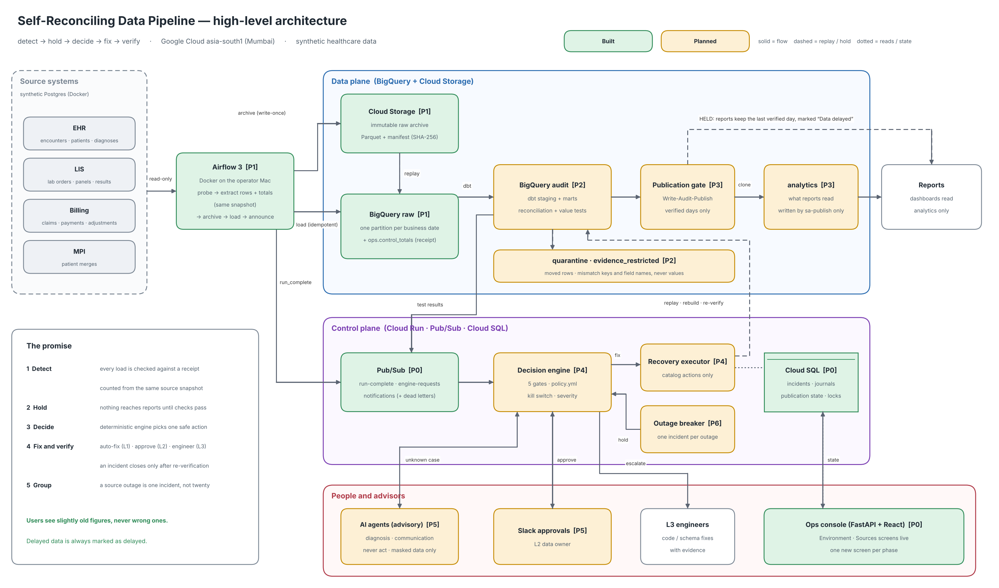
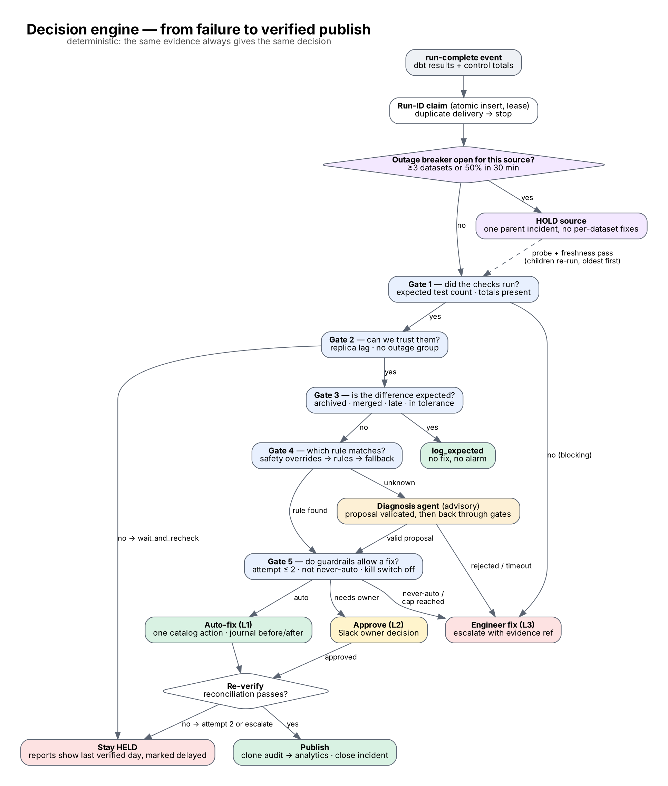

# Runbook — Self-Reconciling Data Pipeline POC (all phases)

A recovery decision engine and remediation for dbt pipelines on Google Cloud, proven on synthetic
healthcare data. This runbook covers **all seven POC phases**: what each one builds, **why it is
needed**, how to run it, and how we know it is done (its exit gate).

| Phase | Name | Status | Exit gate | Last updated |
|---|---|---|---|---|
| 0 | Foundations | ✅ **Built and deployed** (reconcile-poc-29056) | 🟡 3 of 4 passed — destroy + rebuild proof pending | 2026-10-20 |
| 1 | Ingest, control totals and raw archive | ✅ **Built**, ready to deploy | ⬜ | 2026-10-19 |
| 2 | dbt models and reconciliation checks | ⏳ Planned | ⬜ | — |
| 3 | Publication gate and Write-Audit-Publish | ⏳ Planned | ⬜ | — |
| 4 | Decision engine and recovery executor | ⏳ Planned | ⬜ | — |
| 5 | AI agents, approvals and notifications | ⏳ Planned | ⬜ | — |
| 6 | Outage breaker, hardening and demo | ⏳ Planned | ⬜ | — |

Status legend: ⏳ Planned · 🚧 In progress · ✅ Built · ⬜ exit gate not yet checked · 🟡 exit gate partly passed · ☑️ exit gate passed

> **How to read the commands.** Commands under a *built* phase work today. Commands under a
> *planned* phase are marked **(planned)**; they show the interface that phase will add.
>
> **How to update this runbook** as you finish each step: see [§24](#24-updating-this-runbook) and
> record the change in the [change log](#25-change-log).

Source documents: *Architecture design (v4)*, *Understanding & Design*, *Phased POC Implementation
Plan* (16 Oct 2026).

---

## Contents

- **Part A — Understand it:** 1 What the POC proves · 2 The ideas in plain words · 3 Services · 4 The data
- **Part B — Set it up:** 5 Prerequisites · 6 First-time setup
- **Part C — The phases:** 7 Roadmap · 8 Phase 0 · 9 Phase 1 · 10 Phase 2 · 11 Phase 3 · 12 Phase 4 · 13 Phase 5 · 14 Phase 6
- **Part D — Run it:** 15 Test cases T1–T21 · 16 Demo script · 17 Operations · 18 Costs and clean-up · 19 Troubleshooting · 20 Differences from the plan · 21 Team and risks · 22 Repo map · 23 After the POC
- **Part E — Keep it current:** 24 Updating this runbook · 25 Change log

---

# Part A — Understand it

## 1. What the POC proves

> **Bad data is never published, and well-understood failures heal themselves and are re-verified.**

Today our pipelines prove that they *ran*, not that the data is *right*. A nightly load can finish
"green" while 800 encounters are missing, and the first person to notice is a ward manager. Recovery
is manual: L1 searches Splunk and the git runbook within 30 minutes, then escalates to L2 and L3.

The POC adds a control loop around the pipeline: **detect → decide → fix → verify**.

| Step | What happens | Phase that builds it |
|---|---|---|
| Detect | Every load is checked against a receipt from the source | 1 (receipts), 2 (checks) |
| Hold | Nothing reaches reports until the checks pass | 3 |
| Decide | A deterministic engine picks one safe action, or escalates | 4 |
| Advise | AI agents explain unknown failures; humans approve L2 fixes | 5 |
| Group | A source outage becomes one incident, not twenty | 6 |

**The single promise to report users:** you see slightly old figures rather than wrong ones, and
delayed data is always marked as delayed.

**Three response modes** map onto today's support levels:

1. **Auto-fix** (acts as L1, within 30 minutes): safe, reversible, well-understood fixes, such as replaying a missing hour.
2. **Approve** (L2, the data owner): a proposed fix confirmed in Slack, such as remapping a merged patient ID.
3. **Engineer fix** (L3): code, schema or logic problems, handed over with evidence, such as a unit change.

### Architecture diagrams

**High level** — the control loop around the pipeline (green = built, amber = planned):



**Low level** — every component, its service account, the datasets it may write and the phase that
builds it:


**Decision engine** — from a failure to a verified publish (Phase 4–6):



Text version, for quick reference in a terminal:

```
 Synthetic sources (Postgres)             Google Cloud (asia-south1, Mumbai)
 ┌───────────────────────────┐  Airflow  ┌──────────────────────────────────────────────────────┐
 │ EHR     encounters …      │─extract──▶│ Cloud Storage archive (write-once)              [P1] │
 │ LIS     lab_results …     │ + receipt │      │ load                                          │
 │ Billing claims …          │           │      ▼                                               │
 └───────────────────────────┘           │ BigQuery raw + ops.control_totals               [P1] │
                                         │      │ dbt build + reconciliation tests         [P2] │
                                         │      ▼                                               │
                                         │ BigQuery audit ──gate──▶ clone ──▶ analytics    [P3] │
                                         │      │ failures                                      │
                                         │      ▼                                               │
                                         │ Pub/Sub ─▶ Decision engine ─▶ Executor (Cloud Run)[P4]│
                                         │              ▲  └─▶ Slack approvals, agents     [P5] │
                                         │              └── Outage breaker                 [P6] │
                                         │ Cloud SQL ops state · Cloud Run console + API  [P0+] │
                                         └──────────────────────────────────────────────────────┘
```

## 2. The ideas in plain words

**Terraform** — You describe the cloud setup in text files and Terraform builds it. Why: one command
builds the same environment every time, changes are reviewed in git, and `terraform plan` shows when
someone changed something by hand.

**Control totals (the receipt)** — When we extract a table we also count it *in the same database
snapshot*: rows, unique IDs, empty amounts, total ₹. Later the warehouse is checked against that
receipt. Why the same snapshot: the hospital system keeps changing while we read it; counting at a
different moment would create differences that aren't real.

**Three numbers, not one** — 50 missing claims plus 50 duplicates still gives 10,000 = 10,000.
Distinct IDs (9,950) and the ₹ total catch what the count misses.

**Immutable raw archive** — Every extract is saved as a file that can't be overwritten or deleted for
the retention period. A problem found weeks later can be fixed by replaying the original file, even
after the source has archived those records.

**Idempotent** — Running something once or ten times gives the same result. Our loads delete the day,
insert it, write the receipt and log the batch in one transaction, so retries never double data.

**Write-Audit-Publish (WAP)** — Build in `audit`, check, and only then copy to `analytics`, which is
what reports read. A failed check means the old, verified day stays in place, marked delayed.

**Expected difference** — A gap that is correct, not a failure: archived history, merged patients,
records that arrive late. The system recognises and logs them instead of "fixing" them.

**Catalog action** — One of a small, fixed list of safe, repeatable fixes the executor may run. Nothing
else can run automatically. Some actions are **never automatic**: full refresh, rollback, source delete.

**Five gates** — The questions the engine asks, always in this order: (1) did the checks run, (2) can we
trust them, (3) is the difference expected, (4) which rule matches, (5) do the guardrails allow a fix.

**Kill switch** — One setting that turns every automatic action into a recommendation for a human.

**One identity per component** — Each part runs as its own Google service account with only the
access it needs. Permissions enforce the design even if the code is wrong: ingest *cannot* write
`analytics`.

**Impersonation, not key files** — You log in once; components borrow their service-account identity
for an hour. Leaked key files are a common cause of cloud breaches.

**Advisory agents** — AI that reads logs and suggests a cause and a catalog action. It never acts: the
engine validates every suggestion and runs it through the same gates as a rule.

**Outage breaker** — When one source system fails across several datasets at once, the breaker opens
one grouped incident and holds everything from that source, instead of twenty separate fixes fighting
a broken upstream.

## 3. What each Google Cloud service does

| Service | Its job | Phases | Trial cost (approx.) |
|---|---|---|---|
| **BigQuery** | Warehouse: raw, audit, analytics, quarantine, ops, evidence_restricted | 0–6 | Free tier (1 TB queries, 10 GB storage / month) |
| **Cloud Storage** | Immutable raw archive; later the audit-log sink | 1, 6 | Cents |
| **Cloud SQL (Postgres)** | Ops state: request journal, results, publication state, incidents, locks, action journal | 0–6 | ~$10 / month (pause when idle) |
| **Pub/Sub** | Event queues with dead letters: run-complete, engine-requests, notifications | 1, 4, 5 | Free tier |
| **Cloud Run** | Console + API; publish job, engine and executor services | 0, 3, 4 | ~$0 idle |
| **Artifact Registry / Cloud Build** | Store and build container images | 0+ | Cents / free tier |
| **VPC + private services access** | Private network; Cloud SQL has no public IP | 0 | Free |
| **Secret Manager** | Database password; Slack signing secret (P5) | 0, 5 | Cents |
| **IAM service accounts** | One identity per component | 0+ | Free |
| **Cloud KMS** | Key for value-level reconciliation (deterministic encryption) | 2 | Cents |
| **Vertex AI / Gemini Enterprise Agent Platform + Model Armor** | Advisory agents and prompt-injection screening | 5 | Pay per call; off until residency is confirmed |
| **Cloud Monitoring / Logging** | Uptime checks, fallback alerts, audit logs, SLO dashboards | 6 | Free tier |
| **Airflow** (Docker on your Mac for the POC) | Schedules ingest and dbt, retries, visual runs | 1+ | Free |

**The six BigQuery datasets**

| Dataset | Holds | Who can write |
|---|---|---|
| `raw` | Exactly what came from the source, one partition per business date | ingest |
| `audit` | dbt staging and marts, built and tested first | dbt, executor |
| `analytics` | Verified data only; what reports read | **publish only** |
| `quarantine` | Rows moved out of marts (moved, never copied) | dbt, executor |
| `ops` | control_totals, batches, source_health (no clinical values) | ingest (3 tables), engine |
| `evidence_restricted` | Keys and field names of mismatches, never values | value-recon only |

## 4. The data

All patient data is **synthetic** (`data-gen/`, seed 2026). The same date, seed and scale always give
the same rows, so any test result can be reproduced. A **business date** is the India (facility) day;
the systems store UTC, as real hospital systems do.

| Source | Table | Rows / day | One row is… | Main columns |
|---|---|---|---|---|
| EHR | `encounters` | 10,000 | a hospital visit | encounter_id, patient_id, encounter_type, ward, admit_ts, discharge_ts |
| EHR | `patients` | ~1,500 new (+50,000 base) | a person | patient_id, mrn, name, birth_date, sex, facility |
| EHR | `diagnoses` | ~20,000 | a diagnosis on a visit | icd10_code (e.g. E11.9 diabetes), rank |
| LIS | `lab_orders` | ~5,200 | a lab order | priority (routine / urgent / stat), ordering_dept |
| LIS | `lab_panels` | ~6,300 | a panel on an order | panel_code (CBC, BMP, LIPID, HBA1C, LFT) |
| LIS | `lab_results` | ~18,000 | one test result | test_code (GLU, HGB…), result_value, result_unit, reference range, collected_at |
| Billing | `claims` | 10,000 | an insurance claim | payer (PMJAY, CGHS, insurers), claim_amount ₹, status |
| Billing | `payments` | ~6,000 | a payment | paid_amount ₹, method (NEFT, UPI…) |
| Billing | `adjustments` | ~350 | a correction | adjustment_amount (negative), reason_code |
| MPI | `patient_merges` | 3 | "retired ID → surviving ID" | used by the merged-patient rule (P4, P5) |
| EHR | `archive_index` | on demand | an encounter the EHR archived | used to recognise archived history (P4) |

**Mess built in on purpose**, each matching a worked case in the design:

| Edge case | Why it matters | Handled in |
|---|---|---|
| Early-morning visits are "yesterday" in UTC | A naive date filter loses or double-counts them | P1 (facility-day extract) |
| Lab results arrive before their visit exists | Look like broken links; actually "young orphans" | P2 test, P4 `link_unknown_member` |
| Claims reversed days after loading | Old partitions change; need a 3-day look-back | P2 staging |
| Merged patients keep child records on the retired ID | Look like orphans; need an owner-approved remap | P4 rule, P5 approval |
| EHR archives old encounters | Warehouse "exceeds" source; must not be "fixed" | P4 `log_expected` |

**Operational data** the engine also reads: control totals, dbt artifacts (`run_results.json`,
`manifest.json`, `sources.json`), Airflow task states, source probes, releases (GitHub deployments),
`policy.yml`, runbooks, and Slack approvals.

---

# Part B — Set it up

## 5. Prerequisites (on your Mac)

| Tool | Why | Install |
|---|---|---|
| Google Cloud account (free trial) | Hosts the POC | https://cloud.google.com/free (card needed; no charge unless you upgrade) |
| `gcloud` CLI | Log in, deploy, open the console | `brew install --cask google-cloud-sdk` |
| Terraform ≥ 1.6 | Builds the environment | `brew tap hashicorp/tap && brew install hashicorp/tap/terraform` |
| Docker Desktop (4 GB+ memory) | Runs Airflow and the synthetic sources | https://www.docker.com/products/docker-desktop |
| Python 3.11+ and Node 22 | Local tests and dev servers | `brew install python@3.12 node@22`, then `make dev-setup` |

**Python environment.** Create a project venv from Python 3.12 so a different system Python can't
be picked up: `python3.12 -m venv .venv && source .venv/bin/activate`, then `make dev-setup`.

**Windows (no admin rights, tested 2026-10-20).** Use **Git Bash** as the terminal (VS Code / Cursor:
*Terminal: Select Default Profile → Git Bash*). Install tools per-user with **Scoop**:
`scoop install git fnm terraform make`, plus Python 3.12 and gcloud from their manifest URLs
(`…/ScoopInstaller/Versions/master/bucket/python312.json`, `…/ScoopInstaller/Extras/master/bucket/gcloud.json`)
if the buckets can't be added. Then `fnm install 22`, `python312 -m venv .venv`,
`source .venv/Scripts/activate`, `cp .venv/Scripts/python.exe .venv/Scripts/python3.exe`, `make dev-setup`.
Before cloning: `git config --global core.autocrlf input` (Windows line endings break the container scripts).
See §19 for the Windows-specific fixes.

## 6. First-time setup (about 30 minutes, mostly waiting)

**Step 1 — Project and billing.** *Why:* one project keeps costs visible and makes it easy to delete everything.
```bash
gcloud auth login
PROJECT=reconcile-poc-$RANDOM
gcloud projects create $PROJECT --name="Reconcile POC"
gcloud billing accounts list
gcloud billing projects link $PROJECT --billing-account=XXXXXX-XXXXXX-XXXXXX
gcloud config set project $PROJECT
```

**Step 2 — Your login for code (ADC).** *Why:* Terraform, Airflow and scripts use it to borrow
service-account identities; no key files are created.
```bash
gcloud auth application-default login
gcloud auth application-default set-quota-project $PROJECT
```
If `GOOGLE_APPLICATION_CREDENTIALS` is set on your machine (for another project), unset it for this
project, otherwise every tool uses that key instead of your login:
`echo 'unset GOOGLE_APPLICATION_CREDENTIALS' >> .venv/bin/activate` (Windows: `.venv/Scripts/activate`).

**Step 3 — Terraform.** *Why:* builds datasets, the archive, the private network, Cloud SQL, queues,
the image registry and all identities with exact permissions.
```bash
# on a brand-new project, switch on the APIs Terraform itself needs first
gcloud services enable cloudresourcemanager.googleapis.com iam.googleapis.com \
  serviceusage.googleapis.com iamcredentials.googleapis.com --project=$PROJECT
cp infra/terraform.tfvars.example infra/terraform.tfvars   # set project_id and operator_email
make tf-init && make tf-plan        # about 120 resources to add, nothing to destroy
make tf-apply                       # Cloud SQL takes 10–15 minutes
make env                            # writes .env from Terraform outputs
```
Run Terraform from **one machine only**: the state file (`infra/terraform.tfstate`) lives there.

**Step 4 — Local runtime.** *Why:* Airflow runs free on your Mac but drives real GCP; a Postgres
container plays the hospital systems.
```bash
make up                             # http://localhost:8080
make generate DATE=2026-10-13 DAYS=3   # DATE is the LAST day: this loads 11, 12 and 13 Oct
```

**Setup checklist**
- [x] Project created and billing linked
- [x] ADC login done with quota project
- [x] `make tf-apply` finished with no errors; `.env` written
- [x] Airflow UI opens at http://localhost:8080
- [x] Synthetic data generated for at least one business date

Continue with the phase sections below.

---

# Part C — The phases

## 7. Roadmap

Phases run in order because each one depends on the evidence the previous one produces. A phase is
done only when its **exit gate** passes, and the console gains one screen per phase.

| Phase | Data engineering | Cloud engineering | AI engineering | Backend (FastAPI) | Frontend (React) |
|---|---|---|---|---|---|
| 0 Foundations | Synthetic generator | Terraform, IAM, project | Residency check, kill switch | Skeleton, health | Shell, Environment screen |
| 1 Ingest and archive | Extract, control totals | Airflow, archive | — | /sources, /batches | Sources screen |
| 2 Models and checks | dbt models, recon and value tests | Cosmos, KMS identity | — | /reconciliation | Reconciliation screen |
| 3 Publication gate | State table, dependencies | Publish job, clone, IAM gate | — | /publication | Publication ledger |
| 4 Decide and recover | Catalog actions in dbt | Engine on Cloud Run, Pub/Sub, locks | — | /incidents | Incident detail |
| 5 Agents, approvals | Masked views | Agents, Slack app | Diagnosis, Communication, golden set | /agents, /approvals | Agents and approvals |
| 6 Breaker and demo | Failure injectors | Alerting, quotas, audit sink | Evaluation gate in CI | /metrics, /outages | Operations screen |

**Success criteria for the whole POC**

| Criterion | Target | Proven in | Result |
|---|---|---|---|
| Publication safety | 0 publishes of data that failed a blocking check | All phases; injection suite (P6) | — |
| Automatic recovery | Partial extract healed and verified in under 30 minutes | P4, demo 1 | — |
| Blocked publication | Unit change and value mismatch held and escalated | P2–P4, demo 2 | — |
| No false alarms | Archived history and merged patients not flagged as failures | P4–P5, demo 3 | — |
| Shared outage | One grouped incident, zero per-dataset fixes, other sources publish | P6, demo 4 | — |
| Explainability | Every decision shows its gates, policy version and evidence | P4 incident screen | — |
| Agent safety | Malformed, out-of-catalog or injected agent output rejected | P5 contract tests | — |

**Operational SLOs** (proposed; measured during the POC, not yet commitments)

| SLO | Target | Clock | Measured |
|---|---|---|---|
| Detection | Failure detected within 5 min | Run completion → incident opened | — |
| Automated recovery (L1) | Fixed and verified within 30 min, otherwise escalated | Detection → re-reconciliation passes | — |
| P1 notification | L2 notified within 5 min, in parallel with auto-recovery | Detection of a P1 | — |
| Data freshness | Business deadline met (e.g. 06:00 bed meeting) or data flagged delayed | Agreed per dataset | — |
| Publication safety | Zero publishes of data that failed mandatory checks | A hard rule, not a time target | — |

L2/L3 response targets are to be agreed with SRE and support owners.

---

## 8. Phase 0 — Foundations

**Status:** ✅ Built and deployed (project `reconcile-poc-29056`, asia-south1) · **Exit gate:** 🟡 3 of 4 passed 2026-10-20 — destroy + rebuild proof pending

**Goal:** a working, secured, empty platform and realistic synthetic data, so every later phase builds
on the real cloud shape.

**Why it matters:** if identities, networking and datasets are improvised later, the safety rules
("only publish can write analytics") become promises instead of facts. Building them first makes
every later phase inherit them.

| Track | What is built | Where |
|---|---|---|
| Cloud | APIs; 6 BigQuery datasets + ops tables; archive bucket with retention (Bucket Lock opt-in); VPC + private Cloud SQL; Pub/Sub topics + dead letters; Artifact Registry; one service account per component; optional budget alert | `infra/` |
| Data | Deterministic synthetic EHR / LIS / Billing / MPI generator with edge cases | `data-gen/` |
| AI | Agents **off**; residency, BAA and no-training confirmation required; kill switch in policy | `policy/policy.yml`, `agents/registry.yml` |
| Policy | Rules, action catalog, never-auto list; CI rejects unsafe policies | `policy/`, `scripts/check_policy.py` |
| Backend | FastAPI skeleton: `/api/health`, `/api/environment`, `/api/me`; serves the console | `api/` |
| Frontend | App shell (rail, top bar, business-date picker), design tokens, **Environment** screen | `web/` |
| DevOps | CI: lint, tests, policy check, dbt parse, Terraform validate, DAG import, console build | `.github/workflows/ci.yml` |

**Run it**
```bash
make tf-apply && make env               # environment
make generate DATE=2026-10-13 DAYS=3    # synthetic data
make deploy-console && make console     # console at http://localhost:8081 → Environment
```

**What the Environment screen shows:** each resource checked live; the **identity matrix**, read from
the real dataset permissions (so it shows what IAM enforces, not what we intended); synthetic data per
dataset; the policy version, kill switch and agent status.

**Exit gate**
- [ ] `terraform apply` builds the environment from scratch (prove it once with destroy + apply) — *apply succeeded on a new project (106 added after a partial first run; follow-up `tf-plan` should show no changes); the destroy + rebuild proof is still to do*
- [x] The generator loads a business date (`make status`) — 2026-10-20: 11, 12, 13 Oct loaded
- [x] The console loads from Cloud Run and `/api/health` returns `ok` — 2026-10-20: `{"status":"ok"}`, BigQuery `query ok`, Cloud SQL `PostgreSQL 16.15`
- [x] CI is green on GitHub — 2026-10-20: commit `0a08808`, 5 of 5 checks passed

**Notes from the run** *(fill in: date, who, anything that differed)*
- 2026-10-20 · Bhavna · Deployed from **Windows (Git Bash, company laptop, no admin)** into project
  `reconcile-poc-29056` (asia-south1), operator `rathiashish458@gmail.com`.
- First `tf-apply` failed: Cloud Resource Manager and IAM APIs were off on the new project. Enabled
  them with `gcloud services enable …` (now in §6 Step 3); the re-run finished — "106 added, 4 destroyed",
  the 4 being half-created resources from the failed run that Terraform replaced.
- `GOOGLE_APPLICATION_CREDENTIALS` was set to another project's key; unset in the venv activate script.
- `make deploy-console` failed on Windows: `mktemp` gave a `/tmp/…` path that Windows gcloud can't
  read. Fixed in `scripts/deploy_console.sh` with a `cygpath -m` conversion (commit `7ea0254`; no-op on Mac/Linux).
- Company network blocks certificate-revocation checks (`CRYPT_E_REVOCATION_OFFLINE`): affected
  Scoop buckets, `git push` from Git Bash and the deploy script's final curl health check. Push from
  PowerShell worked; health checked with `curl --ssl-no-revoke`.
- Committed `infra/.terraform.lock.hcl` (commit `0a08808`).
- Environment screen: 5 of 8 resources Ready (the other 3 — Airflow runs, KMS key, agents — belong to
  P1, P2, P5); identity matrix matches the design; kill switch off; agents off; policy 1.7.0-poc.1;
  archive retention 7 days, not locked.
- Remaining: `make tf-destroy && make tf-apply` to close the first exit-gate item. Easiest before any
  archive objects exist (retention blocks bucket deletion for 7 days).

---

## 9. Phase 1 — Ingest, control totals and raw archive

**Status:** ✅ Built, ready to deploy · **Exit gate:** ⬜ not yet verified

**Goal:** every extract lands idempotently with a batch ID, writes its own control totals from the
same snapshot, and is archived immutably.

**Why it matters:** reconciliation (P2) needs a trustworthy receipt; recovery (P4) needs an untouched
copy to replay; and retries must never double the data.

| Step | What happens | Why |
|---|---|---|
| Probe | Check the source is reachable; record lag and archive cutoff in `ops.source_health` | Don't extract from a broken source; the console shows health |
| Extract | Rows **and** totals read in one read-only, repeatable-read transaction | Receipt and rows describe the same moment |
| Archive | Parquet + manifest (totals, SHA-256) to `gs://…/raw/<dataset>/load_date=<date>/<batch>.parquet`, write-once | Replayable original, tamper-evident |
| Load | One BigQuery transaction: delete the date, insert the batch, write totals, log the batch | Idempotent; the receipt exists if and only if the rows do |
| Announce | Publish `ingest.run_complete` to Pub/Sub | The engine (P4) starts from this event |

Airflow DAGs: `ingest_ehr`, `ingest_lis`, `ingest_billing` (daily at 01:00 IST, load yesterday) and
`replay_batch`. Console: **Sources and ingestion** screen (source cards; batches with rows landed vs
control total, totals row present / **Missing**, archive object; Replay request button).

**Run it**
```bash
make trigger DATE=2026-10-13            # all three ingest DAGs
make verify  DATE=2026-10-13            # exit-gate checks G1–G5
make replay  DATASET=encounters DATE=2026-10-13
```

Inspect in BigQuery:
```sql
select dataset, batch_id, row_count, distinct_keys, amount_total from ops.control_totals
where business_date = '2026-10-13' order by dataset;
select dataset, batch_id, status, rows_extracted, rows_loaded, archive_uri from ops.batches
where business_date = '2026-10-13' order by finished_at desc;
```

**Failure injectors** (test project only; DAG config `{"inject": [...]}`)

| Injector | Simulates | Console shows | Caught by |
|---|---|---|---|
| `drop_hour` | 02:00–03:00 missing (partial extract) | rows landed < control total, in red | P2 `recon_encounters` |
| `duplicate_rows` | retried batch loads 12 rows twice | rows landed = total + 12 | P2 raw duplicate test |
| `missing_control_totals` | receipt not written | Totals row **Missing** | P2 `control_totals_present` |

**Exit gate** (`make verify`)
- [ ] G1 each dataset lands with exactly one control-totals row per batch
- [ ] G2 re-running the same date gives identical row counts
- [ ] G3 an archived file replays into raw
- [ ] G4 ingest cannot write to analytics (the IAM call is denied)
- [ ] G5 archive objects cannot be overwritten or deleted

**Notes from the run** *(fill in: date, who, anything that differed)*
- —

---

## 10. Phase 2 — dbt models and reconciliation checks

**Status:** ⏳ Planned · **Exit gate:** ⬜

**Goal:** build staging and marts in `audit` and prove each batch against its control totals (counts,
distinct keys, nulls and amounts together), plus value-level checks on critical lab fields.

**Why it matters:** Phase 1 records the receipt; Phase 2 is where the warehouse is actually *checked*
against it. Without these tests a green run still proves nothing about the data.

**What gets built**

| Track | Build |
|---|---|
| Data — models | `stg_encounters`, `stg_claims`, `stg_lab_results` (incremental merge, `row_number()` de-duplication, **3-day look-back** for reversals, `full_refresh: false`); marts `dim_encounters`, `fct_daily_claims`, `fct_bed_occupancy` |
| Data — reconciliation | Singular tests `recon_<dataset>.sql` (count, distinct keys, null amounts, ₹ total vs `ops.control_totals` "as of that batch"); `control_totals_present.sql` (exactly one receipt per dataset, date and batch — otherwise a missing receipt would pass silently) |
| Data — quality | Raw duplicate test (warning); relationships to dimensions with stored failures; value-range and unit tests on glucose; **expected-test-count assertion** (a skipped test is a failure) |
| Data — value level | Macros `canonical_value` and `apply_expected_transform`; `value_recon_lab_results` compares `result_value`, `result_unit`, `collected_at` raw vs staging using BigQuery deterministic encryption with a KMS-wrapped key; mismatches stored as (record_key, field names, key_version) in `evidence_restricted` — never values |
| Policy | Every test carries `meta.policy_outcome`: informational, warning, blocking_unless_explained, blocking, threshold. The gate (P3) reads this, not dbt's severity |
| Cloud | dbt runs from Airflow through **Cosmos** (one task per model + its tests); value reconciliation runs as a separate invocation under `sa-valuerecon`, the only identity with KMS decrypt; `maximum_bytes_billed` on every query; Terraform adds the KMS keyring and key |
| Backend | Results collector parses `run_results.json`, stored failures and recon results into Cloud SQL; `GET /api/reconciliation?date=`, `GET /api/reconciliation/{dataset}/hourly` |
| Frontend | **Reconciliation** screen: results by dataset, hourly source-vs-warehouse chart, value-level panel |
| Injectors | Add `offsetting_errors` (50 missing + 50 duplicated), `unit_change` (glucose mg/dL → mmol/L), `value_truncation` (14 rows rounded to 2 dp) |

**Example:** with `drop_hour` injected, `recon_encounters` fails 10,000 vs 9,200 (distinct keys 9,200)
and the hourly chart shows the gap sits entirely in 02:00–03:00. Claims match after staging drops the
12 duplicates. `dim_encounters` shows +1,200 rows, all before the archive cutoff (expected).

**Run it (planned)**
```bash
make dbt-build DATE=2026-10-13        # (planned) dbt build into audit via Airflow/Cosmos
make dbt-value-recon DATE=2026-10-13  # (planned) value-level reconciliation as sa-valuerecon
make inject SCENARIO=offsetting_errors DATE=2026-10-13   # (planned)
```

**Build checklist**
- [ ] Staging models with look-back and de-duplication
- [ ] Marts `dim_encounters`, `fct_daily_claims`, `fct_bed_occupancy`
- [ ] `recon_<dataset>` and `control_totals_present` tests
- [ ] Expected-test-count assertion
- [ ] KMS keyring + `sa-valuerecon` + `value_recon_lab_results`
- [ ] `meta.policy_outcome` on every test
- [ ] Cosmos DAG in Airflow
- [ ] Results collector, `/api/reconciliation`, Reconciliation screen
- [ ] New injectors: `offsetting_errors`, `unit_change`, `value_truncation`

**Exit gate**
- [ ] Each injected failure (missing hour, duplicates, offsetting 50 + 50, missing totals, unit change, 14-row truncation) produces the expected failing test
- [ ] A skipped test is caught by the expected-count assertion
- [ ] No clinical value or digest appears in `evidence_restricted`

**Test cases:** T3, T4, T5, T6, T7 (§15).

**Notes from the run**
- —

---

## 11. Phase 3 — Publication gate and Write-Audit-Publish

**Status:** ⏳ Planned · **Exit gate:** ⬜

**Goal:** consumers only ever see verified days. The gate decides once per dataset and business
date, and only the publish identity can write `analytics`.

**Why it matters:** checks are useless if bad data still reaches reports. The gate turns "a test
failed" into "this day is held, and reports keep yesterday's verified figures, marked delayed".

**Publication states:** `PENDING` → `PUBLISHED`, or `HELD`, or `PUBLISHED_WITH_CAVEAT` (allowed only
where dbt meta permits a caveat, within a maximum gap, approved by the named owner).

| Track | Build |
|---|---|
| Data | Publication state table per dataset and date (Cloud SQL); dependency map from `manifest.json`, so a mart waits for every upstream dataset; caveat policy from dbt meta |
| Cloud | **Publish job** on Cloud Run as `sa-publish`: re-reads publication state and open breakers **immediately before each clone**, then `CREATE OR REPLACE TABLE analytics.x CLONE audit.x` in dependency order; a BigQuery table snapshot before each publish for rollback |
| Security | Only `sa-publish` can write `analytics` (already enforced since Phase 0) |
| Backend | `GET /api/publication?from=&to=` (ledger grid), `GET /api/publication/{dataset}/{date}` (gate checks), `POST /api/publication/{dataset}/{date}/caveat-request` |
| Frontend | **Publication** screen: verification ledger (datasets × business days), gate checklist for the selected cell, publish log; a "Data delayed: last verified 12 Oct" banner component for consumer dashboards |

**Why clone, not swap:** BigQuery has no atomic schema swap; a clone is fast, cheap and leaves the audit
copy untouched. Re-reading state just before each clone means a fix that finished after its source's
breaker opened still cannot publish.

**Example:** encounters for 13 Oct is held for its count gap. `fct_daily_claims` passes its own checks
but joins encounters, so it also stays on 12 Oct. Claims, lab results and payments publish normally.

**Run it (planned)**
```bash
make publish DATE=2026-10-13          # (planned) run the gate + publish job for a date
make rollback DATASET=fct_daily_claims DATE=2026-10-13   # (planned) restore the pre-publish snapshot
```

**Build checklist**
- [ ] Publication state table and dependency map
- [ ] Publish job on Cloud Run (`sa-publish`), snapshot before clone
- [ ] `/api/publication` endpoints and caveat request
- [ ] Publication ledger screen and "Data delayed" banner

**Exit gate**
- [ ] A held dataset and all its dependants are never cloned
- [ ] A write to `analytics` by any non-publish identity is denied and logged
- [ ] A rollback restores the previous snapshot and re-runs reconciliation on it

**Test cases:** T8, T9.

**Notes from the run**
- —

---

## 12. Phase 4 — Decision engine and recovery executor

**Status:** ⏳ Planned · **Exit gate:** ⬜

**Goal:** turn failures into incidents, decide deterministically with the five gates, run one safe
catalog action, and close an incident only after re-verification.

**Why it matters:** this replaces the manual L1 loop. A deterministic engine gives the same,
explainable decision for the same input, so it can be audited, replayed and trusted.

**How a decision is made**

| Gate | Question | Example answer |
|---|---|---|
| 1 | Did the checks run? | 42 of 42 tests ran; control totals present |
| 2 | Is the check trustworthy? | Replica lag 12 s; no outage group open |
| 3 | Is the difference expected? | Inside the active window; gap 8% > 0.1% tolerance → not expected |
| 4 | Which rule matches? | All 800 missing rows in one hour → `partial_extract` |
| 5 | Do guardrails allow a fix? | Attempt 1 of 2; not never-auto; kill switch off → auto |

The policy runs in **three stages**, so no ordinary rule can override safety: safety overrides first,
ordinary rules next (first match wins, fallback last), the publication gate last.

**Catalog actions**

| Action | Runs as | What it does |
|---|---|---|
| `reextract_from_raw` | Airflow + dbt | Replay the window (archive or source), then `dbt build --select stg_x+` and re-verify |
| `rebuild_partition` | dbt | `insert_overwrite` the affected business date |
| `lookback_rebuild` | dbt | Rebuild the 3-day look-back window (added to the catalog in this phase) |
| `link_unknown_member` | dbt | Point young orphans at the unknown member; re-link next run |
| `quarantine_rows` | dbt | Move rows to quarantine (needs approval) |
| `wait_and_recheck`, `log_expected`, `hold_publish`, `escalate` | orchestrator | No data change |
| `full_refresh`, `rollback`, `source_delete` | — | **Never automatic** |

**Severity and response**

| Severity | Meaning | L1 (engine, within 30 min) | L2 / L3 |
|---|---|---|---|
| P1 | Critical published data wrong or missing, or wide blast radius | Safe fix, with L2 paged at once | Top priority |
| P2 | Important data delayed or partly wrong; last verified day available | Auto-fix within 30 min, then escalate | Normal queue |
| P3 | Low impact, caught before publication | Auto-fix; escalate if it fails | Backlog |

Severity rises when data stays stale past its freshness deadline, so nothing waits unseen.

| Track | Build |
|---|---|
| Cloud | Engine and executor as Cloud Run services fed by Pub/Sub `run-complete` and `engine-requests`; **run-ID claim** with an atomic insert in Cloud SQL (lease, status, takeover limit) so a redelivered message is never evaluated twice; lease-based partition lock; action journal written **before and after** each attempt |
| Engine | Incident key (dataset, date, failure type, scope); evidence-contract completeness check; five gates; severity and mode; attempt cap 2; deployment context from GitHub deployments attached as a clue, never as proof |
| Backend | `GET /api/incidents`, `GET /api/incidents/{id}` (gates, evidence, journal, lifecycle), `POST /api/incidents/{id}/retry` (re-queues through the engine), `PUT /api/settings/kill-switch` |
| Frontend | **Incidents** list and detail: lifecycle stepper, five-gate trace with evidence, action journal, context panel |

**Example:** the engine reads the failed encounter reconciliation, passes the five gates, replays
02:00–03:00, rebuilds, re-verifies 10,000 vs 10,000 and publishes — in about 12 minutes.

**Run it (planned)**
```bash
make deploy-engine                    # (planned) engine + executor to Cloud Run
make inject SCENARIO=partial_extract DATE=2026-10-13   # (planned) watch it heal in the console
```

**Build checklist**
- [ ] Run-ID claims, partition locks and action journal in Cloud SQL
- [ ] Engine: incident key, evidence contract, five gates, severity, mode, attempt cap
- [ ] Executor with catalog actions; never-auto list enforced
- [ ] `/api/incidents`, retry, kill-switch endpoint
- [ ] Incidents list and detail screens

**Exit gate**
- [ ] Every row of the architecture's failure-to-decision table produces the stated decision and mode
- [ ] The same input replayed gives the same decision
- [ ] A duplicate or concurrent event produces one evaluation and no second action

**Test cases:** T10–T14.

**Notes from the run**
- —

---

## 13. Phase 5 — AI agents, approvals and notifications

**Status:** ⏳ Planned · **Exit gate:** ⬜

**Goal:** add advisory judgement for unknown cases and human approval for L2 fixes, without giving any
agent the power to act.

**Why it matters:** rules cover known failures; agents help with the unknown ones by reading logs and
citing evidence, which shortens diagnosis. Approvals keep data owners in charge of fixes that change
meaning (such as a patient remap).

**Precondition:** written confirmation that the model and agent runtime process requests **in India**,
are covered by the **BAA**, and **do not train on prompts**. Until then `agents.enabled: false` (CI
refuses otherwise) and unknown incidents go to a human.

| Agent | Called when | Reads | Produces | Cannot |
|---|---|---|---|---|
| Diagnosis | Incident is unknown or low-confidence | Logs, dbt artifacts, lineage, deployment context, masked data | Root cause, cited facts vs hypotheses, one catalog action, confidence | Write data, see unmasked PHI |
| Communication | An alert, approval or escalation is needed | Incident record, evidence, severity | Slack / ticket text with counts and references only | Include patient identifiers |
| Runbook (later) | Every incident | Git runbooks, past incidents | Matching runbook; drafted update as a PR | Merge or enable rules |
| Code-fix (after the POC) | Engineer-fix incidents | Repo (read), synthetic sandbox | Branch + PR with failing test and fix | Push to main or deploy |

**How a call works:** the engine sends a context bundle → the agent returns strict JSON
(`confirmed_facts[]` each with an evidence reference, `hypotheses[]`, `proposed_action`, `confidence`)
→ the engine validates it (schema, evidence exists, action in the catalog and not never-auto,
confidence ≥ 0.80) → a valid proposal goes through the **same gates** as a rule. Anything else is
rejected and escalated.

**Guardrails:** log and data text is placed in a delimited data section and treated as data, never
instructions (a log line saying "run full_refresh" can't produce that action); Model Armor screens
prompts; every call records agent, model, prompt and policy versions; a timeout escalates as unknown
and never delays the run; a **golden set** of 30 synthetic incidents is replayed before any prompt or
model change, and a worse score blocks the merge.

| Track | Build |
|---|---|
| AI | Diagnosis and Communication agents (Agent Development Kit on Gemini Enterprise Agent Platform, behind Model Armor); registry versions in `agents/registry.yml`; golden set + evaluation script |
| Data | Masked BigQuery views the agents read (no direct table access) |
| Cloud | Agents' identity reads masked views only; Slack app with interactive buttons; approval callbacks verified (signing secret) and logged |
| Backend | `GET /api/agents/proposals`, `GET /api/approvals`, `POST /api/approvals/{id}/decision` (with approver identity), Slack interaction webhook |
| Frontend | **Agents and approvals** screen: proposal with cited facts vs hypotheses, engine validation, provenance bar; approval card; Slack preview |

**Example:** `lab_orders` arrives without a receipt and no rule explains why. The Diagnosis agent cites
the missing row and a 401 from the LIS token endpoint and proposes `retrigger_ingestion` (added to the
catalog in this phase) at 0.86; the engine validates it and routes it through the gates. Separately,
an orphan lab result for merged patient P-2231 waits for the revenue-cycle owner to approve the remap
to P-1187.

**Run it (planned)**
```bash
make agents-eval                      # (planned) replay the golden set; must not score worse
make deploy-agents                    # (planned) only after residency_confirmed: true
```

**Build checklist**
- [ ] Residency, BAA and no-training confirmation received in writing
- [ ] Masked views and `sa-agents` read-only access
- [ ] Diagnosis and Communication agents behind Model Armor
- [ ] Output validation (schema, evidence, catalog, confidence)
- [ ] Golden set of 30 cases + evaluation script
- [ ] Slack app with signed callbacks; approvals API and screen

**Exit gate**
- [ ] Malformed JSON, an out-of-catalog action, missing evidence and low confidence are each rejected
- [ ] A log line instructing `full_refresh` is never accepted
- [ ] An agent timeout escalates without delaying the run
- [ ] Every agent call records agent, model, prompt and policy versions

**Test cases:** T15–T18.

**Notes from the run**
- —

---

## 14. Phase 6 — Outage breaker, hardening and demo

**Status:** ⏳ Planned · **Exit gate:** ⬜

**Goal:** handle correlated source outages as one incident, run the full failure-injection suite, and
present the four demo scenarios with measured results.

**Why it matters:** when the lab interface goes down, twenty per-dataset "fixes" would hammer a broken
source and flood on-call. One grouped incident, one alert and a hold on that source is the correct
response — while billing and EHR keep publishing.

**Breaker rules (LIS in the POC):** opens at **3 failing datasets or 50% of the source's inventory
within 30 minutes**; holds every dataset of the source and its dependants; cancels queued per-dataset
fixes; one parent incident; closes only when **both** the source probe and freshness pass; children
then re-run the five gates, oldest date first.

| Track | Build |
|---|---|
| Engine | Upstream-outage breaker as above |
| Data | Failure injectors in `data-gen/` for every acceptance case: missing hour, duplicates, offsetting errors, missing totals, unit change, value truncation, archived parent, merged patient, schema change, interface down, in-flight replay during breaker |
| Cloud | Fallback alerting through Cloud Monitoring uptime checks; budget alerts and per-service-account BigQuery quotas; audit-log sink to a locked bucket; policy schema validation in CI (already in place) |
| AI | Evaluation gate in CI (golden set) |
| Backend | `GET /api/metrics/kpis`, `GET /api/metrics/modes`, `GET /api/outages`, `POST /api/injections/{scenario}` (test project only, disabled in prod builds) |
| Frontend | **Operations** screen: outage banner, KPI tiles (auto-recovery rate, automated MTTR, stale-data duration, publication blocks, false alarms), incidents by response mode, demo results |

**Example:** the LIS interface is taken down. `lab_results`, `lab_panels` and `lab_orders` fail within
the window; the breaker opens; all three and two dependent marts are held; one alert names the source
and the affected reports. Billing and EHR keep publishing. When the probe and freshness pass, each lab
dataset is re-evaluated and recovers on its own path.

**Run it (planned)**
```bash
make inject-suite                     # (planned) every injector + assertion; expect 0 bad publishes
make demo SCENARIO=1                  # (planned) scenarios 1–4, see §16
```

**Build checklist**
- [ ] Outage breaker in the engine
- [ ] Full injector suite with assertions
- [ ] Fallback alerting, budgets, quotas, audit-log sink
- [ ] Evaluation gate in CI
- [ ] Metrics and outages APIs; Operations screen

**Exit gate**
- [ ] All four demo scenarios pass live in the console
- [ ] The failure-injection suite shows zero bad publishes
- [ ] The KPI baseline is captured for comparison with today's manual process

**Test cases:** T19–T21.

**Notes from the run**
- —

---

# Part D — Run it

## 15. Test cases T1–T21

Each case is a failure injector plus an assertion; together they form the failure-injection suite.

| # | Phase | Injected condition | Expected outcome | Status |
|---|---|---|---|---|
| T1 | 1 | Same date ingested twice | Identical row counts; no duplicates in the raw partition | ✅ automated (unit test + G2) |
| T2 | 1–2 | Control-totals row not written | Blocking failure; publication held | ✅ P1 part (`missing_control_totals`); P2–3 part planned |
| T3 | 2 | Encounters 02:00–03:00 dropped | `recon_encounters` fails 10,000 vs 9,200 | ✅ injector (`drop_hour`); test planned |
| T4 | 2 | Retried batch loads 12 claims twice | Warning on raw; `stg_claims` unique passes | ✅ injector (`duplicate_rows`); test planned |
| T5 | 2 | 50 duplicates + 50 missing claims | Counts match; distinct keys and totals fail | Planned |
| T6 | 2 | `result_value` truncated on 14 rows | Value test blocks; evidence holds 14 keys and field name only | Planned |
| T7 | 2 | Test excluded by a selector | Expected-test-count assertion fails | Planned |
| T8 | 3 | Mart depends on a held dataset | Mart stays HELD; not cloned | Planned |
| T9 | 3 | Non-publish identity writes analytics | Denied and logged in Cloud Audit Logs | ✅ IAM in place (confirmed on the Environment screen 2026-10-20); G4 proves it for ingest |
| T10 | 4 | Partial extract (T3) | Auto-fix: replay, rebuild, re-verify, publish within 30 min | Planned |
| T11 | 4 | Glucose switched to mmol/L | Never-auto; HELD; escalated to L3 | Planned |
| T12 | 4 | Archived encounters and archived parent | Logged as expected; no fix | Planned (archive generator built) |
| T13 | 4 | Same run event delivered twice, and concurrently | One evaluation; no second action | Planned |
| T14 | 4 | Release changes `stg_lab_results`; grain test fails | `suspected_regression`; release attached; no data action | Planned |
| T15 | 5 | Agent returns malformed JSON or non-catalog action | Rejected; escalated | Planned |
| T16 | 5 | Log line instructs `full_refresh` | Not accepted | Planned (policy CI already rejects never-auto) |
| T17 | 5 | Agent platform times out | Escalates as unknown; run not delayed | Planned |
| T18 | 5 | Orphan of a merged patient | Approval request; remap only after approve | Planned (merges generated) |
| T19 | 6 | Three LIS datasets fail together | One grouped incident; zero fixes; billing publishes | Planned |
| T20 | 6 | Replay running when the breaker opens | Replay journaled; publish refuses to clone | Planned |
| T21 | 6 | Probe passes but freshness fails | Breaker stays open | Planned |

## 16. Demo script (four scenarios, live in the console)

| # | Scenario | Inject | Show | Proves | Result |
|---|---|---|---|---|---|
| 1 | **Automatic recovery** | T3 | Reconciliation (hourly gap) → Incidents (five gates, journal) → Publication (13 Oct turns green) | Known failures heal and are re-verified within 30 min | — |
| 2 | **Blocked publication** | T11 | Held day, the never-auto rule, an escalation carrying only an evidence reference | Bad data is never published | — |
| 3 | **Expected difference** | T12 + T18 | Archived rows logged as expected; approval card for the merged patient | No false alarms; owners approve meaning-changing fixes | — |
| 4 | **Shared outage** | T19 | Outage banner, one grouped alert, billing still publishing | Correlated failures handled as one | — |

**Phase 1 preview you can show today:** in Airflow trigger `ingest_ehr` with
`{"business_date": "2026-10-13", "datasets": ["encounters"], "inject": ["drop_hour"]}`. The console's
Sources screen shows encounters landed 9,895 (red) against a control total of 10,012, although the job
was green. Repair with `make replay` or a clean re-trigger.

## 17. Day-to-day operations

| Task | How | Phase |
|---|---|---|
| Nightly ingest | Automatic at 01:00 IST once DAGs are unpaused; loads yesterday | 1 |
| Load a specific day / table | `make trigger DATE=…` or DAG config `{"business_date": …, "datasets": […]}` | 1 |
| Replay from archive | `make replay DATASET=… DATE=…` or the `replay_batch` DAG | 1 |
| Console replay | Queues a request (journal + Pub/Sub); executed by the engine from Phase 4 | 1 → 4 |
| Check reconciliation | Console → Reconciliation | 2 |
| See what reports are showing | Console → Publication ledger | 3 |
| Handle an incident | Console → Incidents (gates, evidence, journal); retry goes through the engine | 4 |
| Approve a fix | Slack button or console → Agents and approvals | 5 |
| Outage | Console → Operations banner; wait for probe + freshness | 6 |
| Kill switch | `policy.yml` `kill_switch: true` via PR (P0–3); `PUT /api/settings/kill-switch` (P4+) | 0 / 4 |
| Change a rule | PR to `policy/policy.yml`, bump `version`; CI validates; every decision records the version | 0+ |

## 18. Costs and clean-up

Continuous cost is **Cloud SQL (~$10 / month)**; Phase 5 adds per-call AI cost only when agents are on.
Everything else scales to zero or stays in free tiers at POC volume; every query is capped at 1 GiB billed.

```bash
gcloud sql instances patch reconcile-state --activation-policy=NEVER    # pause Cloud SQL
gcloud sql instances patch reconcile-state --activation-policy=ALWAYS   # resume
make down                                                               # stop local containers
make tf-destroy                                                         # delete the environment
```
Archive objects inside their retention period (7 days by default) block bucket deletion until they
age out; re-run `make tf-destroy` afterwards, or delete the whole project.

**Bucket Lock** is opt-in because it is **irreversible** (retention can never be shortened and the
bucket can't be deleted until every object ages out). When ready: set `lock_archive_retention = true`
in `infra/terraform.tfvars` and `make tf-apply`. The Environment screen then shows **Locked**.

## 19. Troubleshooting

| Symptom | Likely cause | Fix |
|---|---|---|
| `terraform apply` fails on Cloud SQL / service networking | Peering not ready yet | Re-run `make tf-apply` |
| `terraform apply` fails: "Cloud Resource Manager API has not been used… or it is disabled" | New project; Terraform needs that API to enable the others | `gcloud services enable cloudresourcemanager.googleapis.com iam.googleapis.com serviceusage.googleapis.com iamcredentials.googleapis.com`, wait 2 min, re-run `make tf-apply` |
| Pub/Sub service agent not found | Created on first API use | Re-run `make tf-apply` |
| Budget error "requires a quota project" | ADC without quota project | `gcloud auth application-default set-quota-project $PROJECT` |
| `iam.serviceAccounts.getAccessToken denied` | Impersonation not granted / wrong email | Check `operator_email`; `make tf-apply`; wait 1–2 min |
| ADC login warns `GOOGLE_APPLICATION_CREDENTIALS` is set | Another project's key file overrides your login | `unset GOOGLE_APPLICATION_CREDENTIALS` (add it to the venv activate script) |
| `DefaultCredentialsError` in Airflow | No ADC on the Mac | Setup step 2, then `make down && make up` |
| `probe_source` fails "connection refused" | Postgres container not healthy | `docker compose ps`; `make up` |
| Load fails with a concurrent-transaction error | Two loads touched one table | Airflow retries; pool `bq_load` serialises loads |
| Totals **Missing** without an injector | Load failed after archive | Check `ops.batches.error`; re-trigger the date |
| Console 403 on Replay | Your role is viewer | `ROLE_MAP` uses `OPERATOR_EMAIL` from `.env`; redeploy |
| `make console` asks to install a component | gcloud `cloud-run-proxy` component | Accept the prompt; if it then says "binary not installed", run `make console` again |
| Port 8080 / 5433 in use | Another app | Change the left-hand port in `docker-compose.yml` |
| `make dev-setup` fails with `CERTIFICATE_VERIFY_FAILED` (Mac) | python.org Python without certificates, or wrong Python on PATH | Use a `.venv` built from Homebrew Python 3.12 (§5) |
| `npm ci` crashes: `Library not loaded … libsimdjson` (Mac) | Homebrew `node` (newer) linked instead of `node@22` | `brew unlink node && brew link --overwrite node@22` |
| (Windows) `deploy-console`: `--env-vars-file: File [/tmp/…] does not exist` | Git Bash `mktemp` path not readable by Windows gcloud | Fixed in `scripts/deploy_console.sh` (`cygpath -m`, commit `7ea0254`) |
| (Windows) `CRYPT_E_REVOCATION_OFFLINE` from git / curl / Scoop | Company network blocks certificate-revocation checks | Push from PowerShell or `git config http.schannelCheckRevoke false`; curl: `--ssl-no-revoke` |
| (Windows) pasted command starts with `^[[200~` | Bracketed paste in Git Bash | `bind 'set enable-bracketed-paste off'` (add to `~/.bashrc`) |
| (Windows) `fnm` / Scoop tools "command not found" in Git Bash | Scoop shims not on Git Bash PATH | Add `export PATH="$HOME/scoop/shims:$PATH"` at the top of `~/.bashrc` |
| (Windows) `python` is the wrong version | Another Python first on PATH | Create the venv with `python312 -m venv .venv` |
| (P2) dbt "Access Denied" on raw | dbt not impersonating `sa-dbt` | `SA_DBT` in `.env`; operator needs Token Creator (Terraform grants it) |
| (P4) Same incident evaluated twice | Run-ID claim missing | Check the claims table in Cloud SQL; lease and takeover limit |
| (P5) Agent proposals all rejected | Low confidence or missing evidence refs | Expected behaviour; check the golden-set score |

Add new rows here as you hit problems in each phase.

## 20. Where the POC differs from the plan, and why

| Plan | POC (trial account) | Why | When it changes |
|---|---|---|---|
| Managed Airflow (Composer) | Airflow 3.3.2 in Docker on the Mac | Composer costs a few hundred $/month even idle; the plan lists this fallback | Upload `ingest/dags` to Composer; no code changes |
| Separate data / control-plane / agents projects + VPC-SC | One project, one service account per component | A personal account has no organisation, so VPC-SC and org policies aren't available | Organisation account |
| Console behind IAP, separate static site | One private Cloud Run service (API serves the console), opened via `gcloud run services proxy` | IAP needs an organisation / OAuth brand; the proxy gives the same "Google login only" result | With IAP, split web and API |
| Bucket Lock | Retention policy, unlocked | Locking is irreversible | `lock_archive_retention = true` |
| Cloud SQL HA | Zonal, db-f1-micro | Cost | `availability_type = "REGIONAL"` |
| Batch IDs `b-20261013-01` | `b-20261013-claims-01` | Unique without a shared counter when tables load in parallel | — |
| Splunk | Cloud Logging | Out of POC scope | After the POC |

## 21. Team and risks

| Role | Owns |
|---|---|
| Data engineer | Synthetic data, ingest, dbt models and tests, catalog actions |
| Cloud engineer | Terraform, IAM, Cloud Run, Cloud SQL, Pub/Sub, KMS, CI/CD |
| AI engineer | Diagnosis and Communication agents, registry, golden set, validation |
| Full-stack engineer | FastAPI backend and React console |
| Data owner (revenue cycle) | Approvals, caveat policy, acceptance of demo scenarios |
| Security and privacy reviewer | Deterministic-encryption choice, evidence permissions, AI residency |

| Risk | Effect | Mitigation |
|---|---|---|
| AI residency / BAA confirmation not received | Agents cannot run | Agents behind the kill switch; unknown cases go to a human |
| KMS / deterministic encryption not approved | Value-level check blocked | HMAC-in-Cloud-Run fallback; keep counts, keys and totals |
| Managed Airflow slow to provision | Ingest stalls | Already mitigated: local Airflow in Docker |
| Synthetic data too clean | Demo looks staged | Generator includes late records, time-zone edges, merges, archives |
| Scope creep | POC slips | Out-of-scope list held fixed; extras go to the next stage |

**Open decisions before the pilot**

| Decision | Owner | Status |
|---|---|---|
| AI residency and BAA confirmation | Security and privacy | Open |
| Deterministic encryption vs HMAC | Security and privacy | Open |
| L2/L3 response targets | SRE and support | Open |
| Freshness deadline per dataset (e.g. 06:00 bed meeting) | Data owners | Open |
| Disaster-recovery targets | Cloud engineering | Open |
| Real volumes to replace illustrative thresholds | Data engineering | Open |

## 22. Repository map

```
infra/            Terraform (P0); KMS added in P2, publish/engine services in P3–P4, alerting in P6
data-gen/         Synthetic sources (P0); full injector suite (P6)
ingest/           Extract, archive, load, replay, verify + Airflow DAGs (P1)
dbt/reconcile/    Sources (P0); models, recon and value tests (P2); catalog-action selectors (P4)
policy/           policy.yml rules, catalog, never-auto, kill switch (P0; used from P3–P4)
engine/           Decision engine + executor (P4); breaker (P6)
agents/           Registry (P0); Diagnosis + Communication agents, golden set (P5)
api/              FastAPI: health, environment, sources, batches (P0–1); one router per later phase
web/              React console: Environment, Sources (P0–1); one screen per later phase
scripts/          write_env, deploy_console, check_policy, gen_dbt_sources
.github/workflows CI: lint, tests, policy, dbt parse, Terraform validate, DAG import, console build
docs/RUNBOOK.md   This file
docs/images/      Architecture PNGs (high level, low level, decision flow)
docs/diagrams/    Diagram sources: draw.py (architecture), decision-flow.dot
```

## 23. After the POC

Connect one real source read-only with masked data; add Splunk; turn on learned thresholds in shadow
mode; add the Code-fix agent in its sandbox; agree L2/L3 response targets and freshness deadlines with
the business; move to an organisation account with separate projects, VPC Service Controls and IAP;
move Airflow to Managed Airflow; enable Cloud SQL HA and disaster recovery in asia-south2 (Delhi).

---

# Part E — Keep it current

## 24. Updating this runbook

Do this every time you finish a step, so the runbook always describes what actually exists.

**When you finish a build item** — tick it in that phase's *Build checklist* and, if anything
differed from the plan, write one line under *Notes from the run*.

**When a phase's exit gate passes**
1. Tick every exit-gate box in the phase section.
2. Change the phase's status line from `⏳ Planned` (or `🚧 In progress`) to `✅ Built` and the exit
   gate to `☑️ passed <date>`.
3. Update the table at the top of this file (status, exit gate, last updated).
4. Remove **(planned)** from the phase's commands that now work.
5. Update the *Status* column of the affected test cases in §15 and any results in §7 and §16.
6. Add troubleshooting rows (§19) for anything you hit.
7. Turn the phase green in the diagrams:
   ```bash
   # add the phase number to BUILT_PHASES in docs/diagrams/draw.py, then
   python3 docs/diagrams/draw.py
   dot -Tpng -Gdpi=150 docs/diagrams/decision-flow.dot -o docs/images/decision-flow.png
   ```
8. Mirror the change in `README.md` (progress tracker, badge, phase section).
9. Add a line to the change log below and commit:
   ```bash
   git add README.md docs/
   git commit -m "docs: phase N exit gate passed"
   ```

**Keep headings stable.** README links point at the phase headings (for example
`#10-phase-2--dbt-models-and-reconciliation-checks`), so change the status line under a heading, not
the heading itself.

## 25. Change log

| Date | Phase | Change | By |
|---|---|---|---|
| 2026-10-20 | 0 | Phase 0 deployed to `reconcile-poc-29056`; exit gate 3 of 4 passed (generator, console health, CI); destroy + rebuild pending. Added Windows setup notes, new-project API step and troubleshooting rows; `deploy_console.sh` Windows fix (`7ea0254`); Terraform lock file committed (`0a08808`) | Bhavna |
| 2026-10-19 | All | Runbook moved into the repo with README, architecture diagrams and progress tracking | — |
| before 2026-10-19 | 0–1 | Phase 0 and Phase 1 built and ready to deploy | — |
